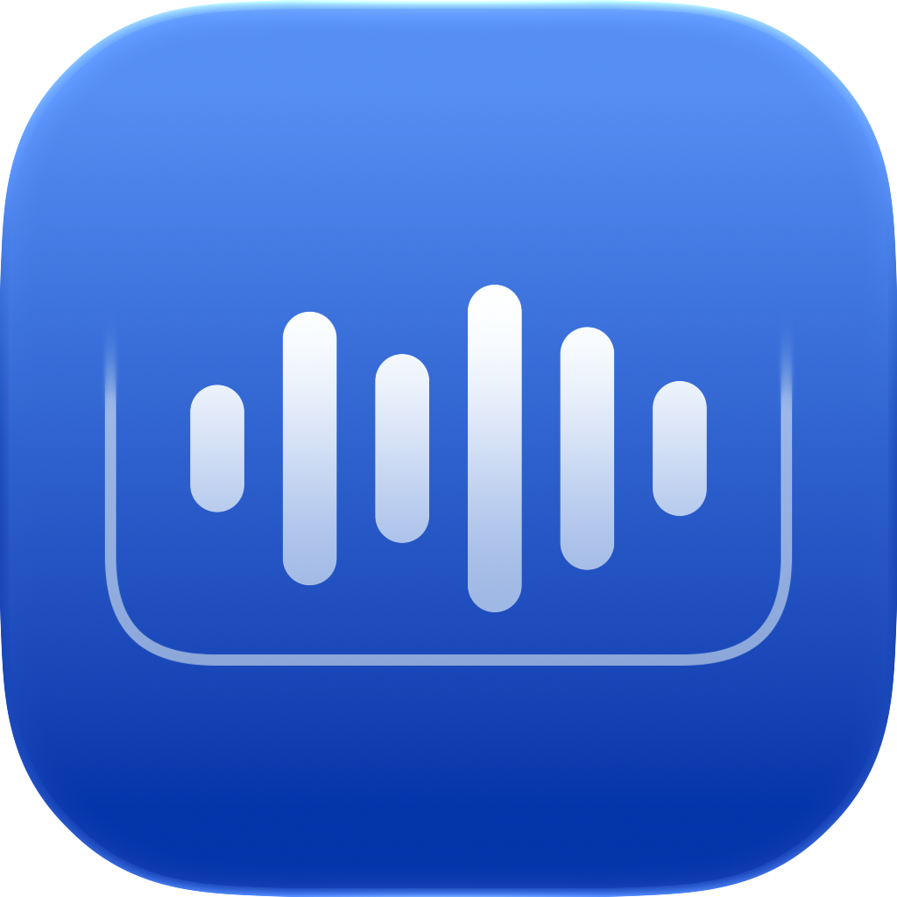

<h1 align="center">AirIsland</h1>

A lightweight home for live activities on your Mac.

<a href="README.md">简体中文</a> · English

<a href="https://github.com/potato0620/AirIsSland/releases/latest">Download the latest release</a> · <a href="docs/INSTALLATION.md">Installation guide (Chinese)</a>

AirIsland brings music, reminders, timers, and system feedback to the top of your Mac’s screen. It stays tucked away when idle, shows useful information during an activity, and expands when you need to interact.

It works with notched and notchless displays, including setups with multiple monitors.

## Features

- **Music**: See the current track, artwork, and live audio spectrum. Control playback, skip tracks, and seek. A brief preview shows the title and artist when the track changes. Lyrics are currently unavailable because the macOS Now Playing interface does not provide them.
- **Reminders**: Connect to Apple Reminders, view all lists or a selected list, and add, edit, or complete tasks from the island.
- **Timer**: Scroll to set a duration, then start, pause, or resume the countdown. The island expands when time is up, with an option to restart for the same duration.
- **System feedback**: See brief indicators for volume, display brightness, keyboard backlight, and power state changes.

## Everyday use

Expand the island with a click, hover, or keyboard shortcut. Swipe left or right with two fingers, or click the page dots, to switch cards. Open settings from the island’s context menu or the menu bar.

AirIsland adapts to light and dark mode and respects Reduce Motion. Settings let you choose displays, adjust the width on notchless screens, and configure hover behavior and haptic feedback.

The audio spectrum analyzes only the current player and audio helper processes inside its app bundle. Audio is never saved or uploaded. Permissions for reminders and system feedback are requested when you use the relevant features.

### Reminders

Expand the island and switch to the Reminders page. On first use, click **Connect Reminders** and grant access when macOS prompts you.

- **Edit a reminder.** Click its text to edit it in place, then press **Return** to save it to Apple Reminders. Press **Esc** or switch pages to discard the edit. Clicking outside the island also discards the edit and collapses the island.
- **Open Apple Reminders.** Click the **blue reminder count** in the upper-right corner of the Reminders page.
- **Add a reminder.** Click the plus button and enter the text. Press Return or click the checkmark to save, or click the X to cancel.
- **Complete a reminder.** Click the circle to its left. The change syncs to Apple Reminders.

## Download and install

Current release packages support **Apple Silicon Macs running macOS 15 or later**.

Download the DMG from the [releases page](https://github.com/potato0620/AirIsSland/releases/latest), drag AirIsland into Applications, and open it. See the [installation guide](docs/INSTALLATION.md) (Chinese) for first launch, permissions, and updates.

## More information

[Feature and interaction details](docs/FEATURES.md) · [Installation, permissions, and updates](docs/INSTALLATION.md) · [Contributing](CONTRIBUTING.md)

These detailed guides are currently in Chinese.

## Credits and license

Based on [TheBoredTeam/boring.notch](https://github.com/TheBoredTeam/boring.notch), independently maintained and released by this repository. Thanks to the original authors and all contributors.

The code is licensed under [GPL-3.0](LICENSE). Existing copyright notices, contribution history, and dependency licenses are preserved.
