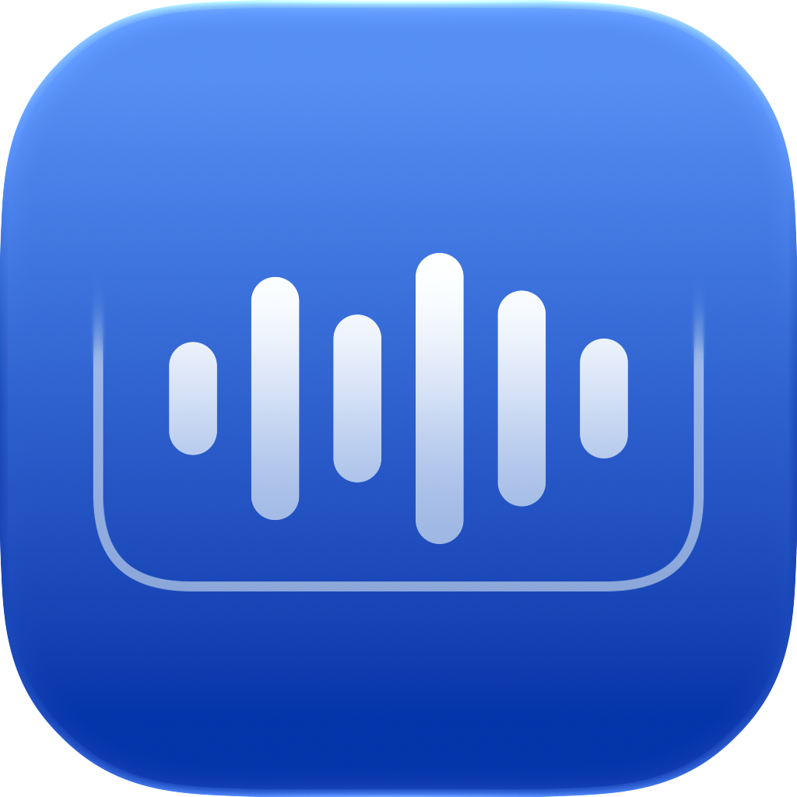

<p align="center"></p>
<h1 align="center">AirIsland · 轻岛</h1>
<p align="center">Mac 上轻量的实时活动入口。</p>

[下载最新版本](https://github.com/potato0620/AirIsSland/releases/latest) · [设计与活动规范](docs/DESIGN.md) · [三层架构](docs/ARCHITECTURE.md) · [AI 开发规范](AGENTS.md) · [贡献指南](CONTRIBUTING.md)

## Air 的含义

**没有活动时安静收起，有活动时一眼看懂，需要操作时轻轻展开。**

AirIsland 借鉴 [Apple Live Activities 与灵动岛设计指南](https://developer.apple.com/design/human-interface-guidelines/live-activities)：围绕有开始和结束的活动，提供简洁、及时的信息与必要操作。我们将这些原则适配 Mac 的鼠标、键盘、多显示器和刘海区域。这是独立实现的 macOS 应用，并非 Apple 的系统灵动岛或 ActivityKit 插件平台。

岛是活动入口，不是另一个桌面、应用启动器或工具箱。不会为了填满空间而常驻日历、天气、聊天记录或无意义动画；空闲就是一种完整状态。

## 当前范围

| 能力 | 岛上的行为 |
| --- | --- |
| 音乐 | 统一使用系统“当前播放”读取网易云等应用的播放状态；收起时展示状态，主动展开后提供封面、进度和必要控制；同曲调整进度不翻转封面、不触发切歌速览 |
| 提醒事项 | 按需授权连接系统提醒事项，默认汇总全部列表的未完成项，也可在活动设置中选择某个列表；新增写入所选列表，“全部事项”下使用系统默认列表；按系统创建时间从早到晚排列，新建事项在后，完成操作同步回原列表；新增输入在界面更新完成后取得键盘焦点；只在启用后的展开面板中展示，数量位于标题行右侧并使用蓝色，点击数量可打开系统“提醒事项”应用，收起时不常驻；关闭后停止同步并移除页面 |
| 计时器 | 空闲时直接显示时／分／秒滚轮和开始按钮，默认 00:25:00；运行或暂停时点击叉会取消计时并回到重置后的选择页；结束时直接展开完整计时页，使用动态闹钟图标并持续保留，点击“重新计时”沿用本次时长开始新计时，或点击叉关闭并恢复其他活动；关闭计时器功能会取消计时并移除页面 |
| 系统反馈 | 调节音量、显示器亮度、键盘背光，或电源状态变化时，在收起的岛内短暂反馈并自动收回；展开时不显示系统调节提示 |

已移除文件暂存、拖放接收、文件预览与分享，以及首页常驻日历、镜子、闲置人脸、歌词查询、自定义 Lottie 动画管理和播放按钮编排器。图标固定使用 AirIsland 品牌；短暂活动统一在岛内呈现。此前暂存的用户文件、书签和持久化记录保留在原位置，应用不再读取或清理这些数据。

目前没有接入 AI 服务。未来 AI 能力也只能以真实任务的进度、完成摘要或待确认操作接入；长对话、参数配置和完整结果应进入独立窗口，不提前放置空入口。

## 必须遵守的三层架构

```text
活动层：发生了什么，当前状态是什么，何时结束
   ↓ 提交 / 更新 / 结束
调度层：现在展示谁，何时收回，如何恢复被打断的活动
   ↓ 单一当前活动
呈现层：收起 / 短暂强调 / 主动展开，统一布局与交互
```

**今后的人工开发与 AI 开发都必须遵循这三层职责。** 功能来源不得直接操作岛的尺寸和动画；视图不得自行决定活动优先级或另开收起计时器。三层架构是功能接入约束，不能用“快速实现”绕过。

当前实现入口：`Activities/IslandActivity.swift`、`Scheduling/ActivityScheduler.swift`、`Scheduling/ActivityCoordinator.swift`、`Presentation/IslandPresentation.swift`，均位于 `AirIsland/` 下。现有媒体和系统管理器提供活动事实；原有窗口与具体 SwiftUI 控件继续复用。详见[职责、数据流与扩展步骤](docs/ARCHITECTURE.md)。

## 设置

设置按用户要做的事组织，不把内部架构术语暴露给用户：

- **活动**：音乐与系统反馈的启用条件和权限；电源状态通知整合在系统反馈中。
- **显示与交互**：显示器、刘海适配、悬停、手势、快捷键和统一外观。无刘海屏幕的基础宽度默认占各自屏宽的 10%，可调整为 5%～10%，并限制在 120～320 点；展开固定取基础宽度的 2.5 倍（限制在 400～960 点和屏幕可用宽度内），此设置不影响有物理刘海的屏幕。
- **通用**：登录启动、菜单栏入口、隐私与系统兼容。
- **关于**：版本、检查更新、项目来源。

音乐频谱为六柱，使用官方 Core Audio 进程采集与 Accelerate 频段分析；六柱共用固定大小的绘图画布，由分析器平滑后的约 30 Hz 帧直接驱动，不为每根柱反复布局或叠加逐帧动画，仅在切歌重置或暂停时用 0.18 秒平滑回落；默认启用且不提供单独开关，实际播放且频谱可见时由系统按需申请音频采集权限，要求 macOS 14.2 或更新版本。只分析当前播放器及其应用包内的音频辅助进程，不采集全系统混音，不保存或上传音频。常规收起音乐活动在无权限、没有数据或减少动态效果时显示静态柱形；切歌速览只保留封面、歌名和歌手，不显示频谱或频谱占位。收起频谱的最大高度与小封面同高，实际幅值跟随音频；展开音乐页在歌名/歌手区域右上角显示同一份六频段数据，预留独立文字间距。采集仅在音乐播放且收起音乐活动或展开音乐页可见时运行，多屏共用同一来源；所有音乐视图隐藏、暂停、关闭或失去来源时停止。

音乐文字和频谱固定使用封面配色，岛内不显示设置按钮和常驻电量，不再提供“外观”配置。设置可通过菜单栏或岛的右键菜单点击打开，暂不提供设置窗口快捷键；“活动 → 媒体”中的“音乐光影背景”可开启或关闭音乐页底部渐变。

播放中通过岛内上一曲/下一曲切歌时，进度条沿与频谱相同的 0.18 秒缓出曲线归零，并在加载期间保持为零，新歌曲确认播放后恢复实际进度；切歌取消或失败时恢复来源的真实进度，同曲拖动进度仍正常生效，减少动态效果时直接归零。

提醒事项和计时器默认开启，仍可在各自活动设置页关闭；歌曲播放变化速览也默认开启并保留开关，已有明确的关闭偏好继续保留。

有刘海屏幕的展开面板为 480 × 190，无刘海屏幕按基础宽度的固定倍数派生宽度、高度保持 190，音乐页始终保留，待办、计时器只在各自启用时加入横向分页；关闭后移除整页，不留下启用按钮。“显示与交互”中的“显示分页指示器”默认开启，可隐藏左上角圆点并保留多页滑动与原有布局。只剩一页时隐藏左上角圆点并停用分页手势，启用两页及以上才显示对应数量的圆点。移除当前页时回到音乐页，移除其他页时保留当前选择并重新计算位置；物理刘海安全区的顶部留白不因圆点隐藏而改变。没有当前实时活动时，重新展开恢复本次运行中最后手动浏览的启用页面；初次展开仍按已有默认页选择，不创建空活动。默认按调度优先级选择收起活动（计时高于音乐）；手动切页或点击分页圆点时，仅将音乐或计时页对应的有效活动设为常驻项，浏览待办页不会改变常驻选择。空页面不会创建活动，常驻项结束或关闭后恢复默认优先级。切歌的歌名/艺人速览与音量、亮度同属高优先级临时展示，按原期限结束后恢复常驻项；计时结束的待确认提示仍优先于它们。阈值前跟随手势并有阻力，未触发时松手回位；达到阈值后用 0.14 秒无惯性过渡落位，同次手势最多切一页，忽略惯性尾段。仅在展开状态主动切回音乐页时，封面与应用角标从左向右稍后追入，使用统一弹簧阻尼，翻页和背景时序保持原样；收起后重新展开只跟随岛的几何过渡，不重复追入；减少动态效果时直接落位。新增操作只在各自页面内提供，不增加跨页面操作菜单。没有任务的页面只在用户主动展开时提供创建/授权入口，不注册虚构活动。

待办完成先保存到系统，成功后立即更新数量并显示勾选、行退场与连续补位；最后一项也保留确认反馈。计时器的开始/取消使用同一个橙色按钮和统一几何进度，暂停/继续保持位置稳定；业务计时与取消立即生效，按钮按压及新增待办输入沿用同一曲线，支持减少动态效果。

计时结束后点击关闭或重新计时，结束页保持原样随岛收起，接近收起完成时再更新页面；关闭后下次查看计时页恢复默认 00:25:00 选择，重新计时则立即开始原时长的新计时，不先闪出 00:00 或运行页。

已有待办文字不设置悬停效果，点击后才启用原生编辑控件与输入指针，文字位置与样式保持不变，直接出现输入光标进行原位编辑，不显示输入框外框或文字过渡，回车保存到系统提醒事项，Esc 或切页取消未保存的编辑；点击展开岛以外的区域同样取消草稿并收起岛；只有点击左侧圆圈才完成待办。右上角数量默认明亮，悬停时仅略微降低文字不透明度，点击仍打开系统“提醒事项”。新增时同一个加号按钮向左移动并过渡成勾，主按钮移开后右侧叉号才淡入；回车或点击勾保存成功后，勾向右移回并过渡成加号，叉号先淡出，主按钮再进入右侧位置，取消也沿同一路径收回；失败则保留输入。

音乐、提醒事项和计时器卡片的内容共用展开／收起模糊过渡，直接跟随岛的几何进度，收起完成前保留退场内容，两种布局的频谱都继续更新至完全隐藏；减少动态效果时不模糊。

计时滚轮使用纵向滚动，因此移除了旧的双指上下展开/收起及相关设置；点击、悬停、快捷键继续可用。所有应用内触控板反馈共用“启用触感反馈”开关，不为每个控件增加开关或强度配置。

调度优先级与提示时长统一由代码管理，不提供每项活动各自选择浮层位置、动画和优先级的开关。新增活动复用活动设置列表，避免继续增加顶级分类。

首次启动使用两步布局一致的独立欢迎窗口，采用系统材质与原生按钮；在“开始使用”后演示双指左右滑动切换卡片，并提示左上角圆点也可切换，以及右键菜单和菜单栏中的设置入口。演示使用内置静音画面，不连接播放器或创建任务；窗口隐藏、失去前台或关闭时停止播放，开启“减少动态效果”时使用静态图示。

## 安装

从发布页下载 DMG，将 AirIsland 拖入「应用程序」。发布包为 Apple Silicon 版本，要求 macOS 14 或更新版本。发布页表示已发布版本，仓库主分支可能包含尚未发布的改动。

当前独立发行包使用本地签名，尚未经过 Apple 公证。首次打开如被系统拦截，可在「系统设置 → 隐私与安全性」中允许打开。带更新器的版本可通过关于页或菜单栏的“检查更新…”手动检查、下载并确认安装重启；2.8.9 及更早版本需要先手动安装一次带更新器的版本。手动替换前先退出旧版应用；应用标识保持一致以保留偏好设置。已移除功能的旧偏好不再读取，无需清除所有设置。

系统反馈替换为可选功能，启用时才申请辅助功能权限。除标准媒体键外，也兼容通过 F14/F15 发送的亮度功能键（例如 HHKB 的 Fn+O/P）；保留 Command/Control 组合和原生 Option 操作。音乐统一使用系统“当前播放”，不再提供媒体来源选择或专用客户端连接；系统接口不可用时不自动切到其他来源。针对当前播放器的必要控制仍按需请求权限。提醒事项页面默认启用，仍需用户点击连接才申请 EventKit 提醒事项权限；不申请日历事件、联系人或摄像头权限。关闭同步或失去权限时撤下待办活动，旧异步读取不能恢复失效数据。

计时器只保存本应用当前计时的标识、阶段和截止时间；睡眠唤醒及重启后按实际截止时间恢复/结束，取消只删除这项记录。关闭计时器功能会取消当前计时。倒计时通知由应用运行期间的岛内提醒提供，不创建系统通知或后台守护进程。

更新使用本仓库独立的签名更新源，详细的构建、验签与发布顺序见[应用内更新说明](docs/UPDATES.md)。

## 开发与验证

开始前阅读 [AGENTS.md](AGENTS.md)、[设计规范](docs/DESIGN.md)和[架构说明](docs/ARCHITECTURE.md)。使用完整 Xcode 打开 `AirIsland.xcodeproj`，选择 `AirIsland` scheme 构建。源码目录、工程、scheme、应用和主进程统一使用 AirIsland，辅助服务为 AirIslandHelper。仅已发行版本的 bundle ID、偏好存储键和文件数据路径保持兼容。

```sh
bash Tests/run-activity-tests.sh
bash Tests/run-media-playback-tests.sh
bash Tests/run-music-spectrum-tests.sh
python3 Tests/check-architecture.py
python3 -m unittest discover -s .github/scripts/tests
```

若命令行当前选择的是 Command Line Tools，可为命令设置 `DEVELOPER_DIR=/Applications/Xcode.app/Contents/Developer`。

回归测试直接编译生产调度模型、媒体状态与封面转换模型。它们覆盖活动抢占、恢复、过期合并、切歌和封面清晰度更新；不能替代真实音乐软件、多显示器和系统权限验收。具体见 [Tests/README.md](Tests/README.md)。

## 来源与许可

本项目基于 [TheBoredTeam/boring.notch](https://github.com/TheBoredTeam/boring.notch) 开发，感谢原作者和所有贡献者。AirIsland 由本仓库独立维护与发布。

代码遵循 [GPL-3.0 许可证](LICENSE)。原有版权声明、贡献记录以及依赖各自的许可继续保留。
