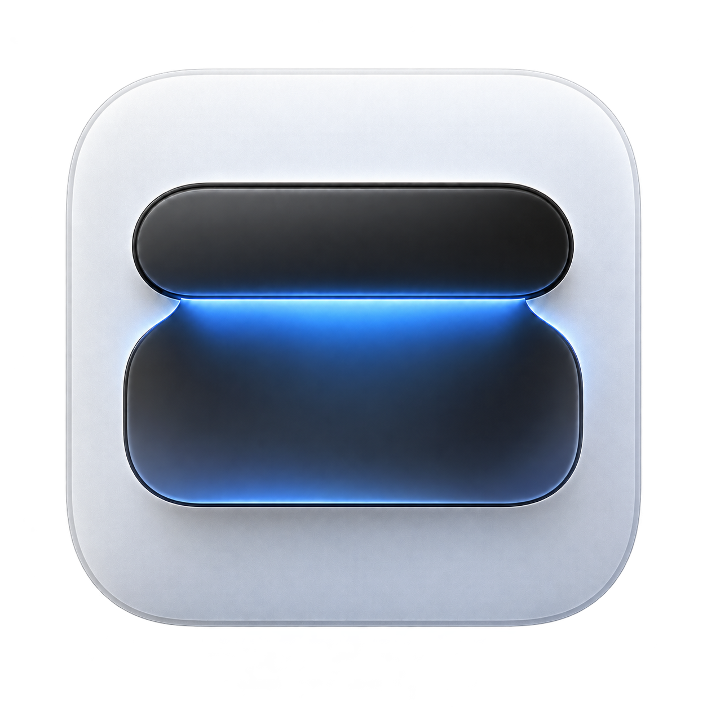

<p align="center"></p>
<h1 align="center">轻岛</h1>
<p align="center">让 Mac 的刘海区域，成为轻巧的桌面控制中心。</p>

[下载最新版本](https://github.com/potato0620/boring.notch/releases/latest) · [查看所有版本](https://github.com/potato0620/boring.notch/releases)

轻岛支持音乐控制、日历、文件暂存、电量提示和音量、亮度浮层，并提供简体中文设置。

- 修复网易云切歌后歌曲信息、进度和封面停滞的问题。
- 封面以弹簧翻转动画切换，灵动岛内的上一曲和下一曲使用相反方向。
- 切歌等待新封面时保留原封面，避免应用图标在两首歌之间闪现。

## 安装

下载发布页中的 DMG，将「轻岛」拖入「应用程序」。当前提供 Apple Silicon 版本，要求 macOS 14 或更新版本。

当前独立发行包使用本地签名，尚未经过 Apple 公证。首次打开如果被系统拦截，请在「系统设置 → 隐私与安全性」中允许打开。旧版用户可先退出 boringNotch，再安装轻岛；应用标识保持一致以保留已有偏好设置。

更新请使用设置中的下载入口，或直接访问本仓库的 GitHub Releases。

## 开发

使用 Xcode 打开 `boringNotch.xcodeproj`，选择 `boringNotch` scheme 构建。工程文件和内部标识沿用原名称，以保持设置、辅助服务和依赖兼容。

播放状态回归检查：

```sh
bash Tests/run-media-playback-tests.sh
```

发布工具检查：

```sh
python3 -m unittest discover -s .github/scripts/tests
```

## 来源与许可

本项目基于 [TheBoredTeam/boring.notch](https://github.com/TheBoredTeam/boring.notch) 开发，感谢原作者和所有贡献者。轻岛由本仓库独立维护与发布。

代码遵循 [GPL-3.0 许可证](LICENSE)。原有版权声明、贡献记录以及依赖各自的许可继续保留。
